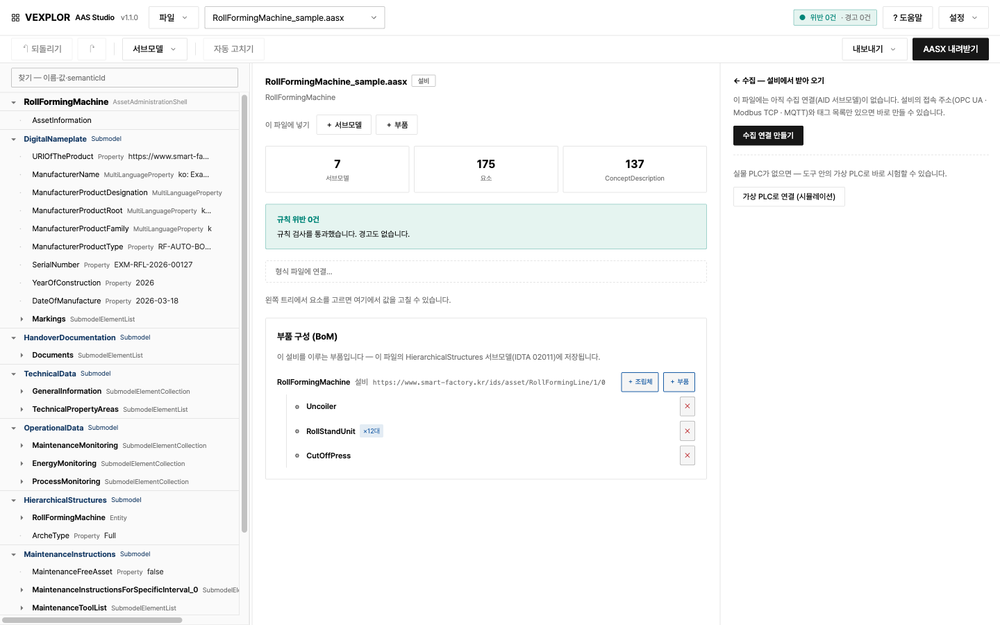

[English](README.md) · **한국어**

# VEXPLOR AAS Studio

**AAS(Asset Administration Shell)를 만들고 · 검증하고 · 내주고 · 현장 값까지 모으는 일을 웹 화면 하나로.**
설비 한 대의 AASX를 올리면 무엇이 규칙에 어긋나는지 짚어 주고, 고칠 수 있는 것은 한 번에 고칩니다.



지금까지는 도구 셋을 오가야 했습니다. 이 프로그램은 그 일을 한곳에 모으고, **AAS를 처음 다루는 사람도**
따라올 수 있게 했습니다.

| 하던 일 | 예전 도구 | 여기서는 |
|---|---|---|
| AASX 열기 · 고치기 · 내려받기 | AASX Package Explorer (설치형) | 브라우저에서 · 고칠 자리를 짚어 주고 자동으로 고칩니다 |
| 다른 시스템에 AAS 내주기 (Part 2 REST · 레지스트리) | Eclipse BaSyx 서버 | 같은 서버가 내줍니다 |
| 설비 값 모으기 · 상위 앱에 구독으로 내주기 | 별도 OPC UA 클라이언트 · 서버 | AAS 안의 AID대로 모으고, OPC UA 서버로 내줍니다 |

> 위 도구들과 제휴하거나 그 소스를 쓴 것이 아닙니다 — 같은 일을 하나로 묶었다는 뜻입니다.

**처음이라면** 첫 화면의 **「견본으로 시작하기」**를 누르십시오. 다 채운 설비 1종과 공정 구성이 열립니다.

**홈페이지:** [wace.me/platform-aas-studio](https://wace.me/platform-aas-studio)

**문서:** [사용법](docs/사용법.md) · [설치](docs/설치.md) · [배포 · 호스팅](docs/배포_호스팅.md) · [검사 규칙 43종](docs/규칙_목록.md)
— 모든 문서에 영어판이 있습니다.

---

## 왜 만들었나

표준 검증을 전부 통과한 AASX가 **제출처의 검증기에서는 떨어집니다.**

AAS 메타모델(aas-core) · 공식 JSON 스키마 · BaSyx 적재를 모두 통과해도, 국내 제출처 검증기(KOSMO
Validator)는 semanticId 허용 목록 · 필수 서브모델 · 패키지 구조 같은 **사업 규칙**을 따로 봅니다.
그 규칙은 표준 문서에 없어서, 떨어지고 나서야 알게 됩니다.

이 도구는 그 규칙을 린터로 구현해 **제출 전에** 걸러 줍니다. 표준과 제출처가 서로 어긋나는 자리는
한쪽을 조용히 고르지 않고 **정책으로 드러내** 사용자가 정하게 합니다.

> **최종 합격 판정은 제출처의 검증기가 합니다. 이 도구는 제출 전 사전 점검입니다.**

## 할 수 있는 일

| | |
|---|---|
| **열기 · 고치기** | AASX(JSON · XML)를 올려 트리로 보고 값 · 요소 · 서브모델 · 용어(ConceptDescription)를 고칩니다. 서브모델 값 표나 CSV 설비 대장으로 여러 값을 한 번에 채웁니다 |
| **검사** | 규칙 [43종](docs/규칙_목록.md) — 패키지 구조(L1) · 메타모델 제약조건(L2) · 제출처 사업 규칙(L3) |
| **자동 고치기** | 고칠 수 있는 지적(규칙 19종)을 미리 보고 골라서 한 번에 고칩니다. 무엇을 바꿨는지 이관 대장에 남습니다 |
| **검증 결과서** | 인쇄하면 PDF가 되는 HTML 결과서 |
| **채울 것 표시** | IDTA 템플릿을 설치해 두면 값 표의 줄마다 필수 · 수집 · 선택이 붙고, 「채울 것만 보기」로 나머지를 숨깁니다 |
| **되돌리기 · 이력** | 실수를 한 번에 되돌리고, 서브모델을 지난 시점으로 복원합니다 |
| **형식과 호기** | 형식 파일을 호기별로 나누고, 형식이 바뀌면 바뀐 곳을 줄마다 보고 고른 줄만 받아 옵니다 — 현장에서 고친 값은 덮지 않습니다 |
| **공정 묶음** | 회사 → 라인 → 공정 → 설비 → 부품. 설비 여러 대를 공정으로 묶어 제출용 꾸러미(레퍼런스 번들)로 내보냅니다 |
| **현장 값 수집** | OPC UA · Modbus TCP · MQTT 설비에서 값을 모읍니다. 주소는 AAS 안의 AID(Asset Interface Description) 서브모델이 정합니다. 값마다 받는 중 · 끊김 · 값 없음을 보여 주고, 설비마다 하루 상태(가동 · 정지 · 알람) 막대를 그립니다. 같은 꼴의 태그는 패턴 하나로 여러 개를 담습니다 |
| **표준 API** | IDTA Part 2 REST API — 다른 시스템이 이 서버의 AAS를 읽어 갑니다 |
| **MES · ERP · CMMS 연동** | 모든 변경과 가동 사건을 순서대로 읽어 가는 주소(CloudEvents), 서명한 웹훅과 MQTT, 설비 · BOM · 공정 계층 · 보전 계획 · 문서 목록 내보내기(JSON · CSV), AASX 옆에 보관하는 ERP 번호, 서버에서 판정하는 상태 · 알람 · 계수기 · 한계값 규칙. OPC UA 서버는 계정과 암호화로 보호합니다. [docs/연동.md](docs/연동.md) |
| **계정** | 관리자 · 편집자 · 열람자. 변경 이력에 누가 고쳤는지 남습니다 |
| **한국어 · 영어, 밝은 · 어두운 화면** | 화면 글자**와** 서버가 만드는 글(지적 문구 · 규칙 설명 · 검증 결과서 · 번들 README · 오류)이 한국어와 영어로 나옵니다. 고른 적이 없으면 브라우저 언어를 따릅니다(한국어 브라우저는 한국어, 그 밖은 영어). 밝은 화면과 어두운 화면이 있습니다 |

## 바로 써 보기

### Docker — 가장 쉽습니다

```bash
git clone <이 저장소> && cd <폴더>
cp .env.example .env          # POSTGRES_PASSWORD만 채우면 됩니다
docker compose up -d --build
```

브라우저에서 `http://localhost:8080`. 자세한 것은 [설치.md](docs/설치.md).

### 소스에서 — Node.js 24 LTS 권장(22 이상이면 동작)

```bash
npm install
npx tsc -b                       # 빌드
npm run build --workspace apps/web
node apps/api/dist/server.js     # http://localhost:8080
```

아무 설정 없이 띄우면 **그 컴퓨터에서만** 열립니다(127.0.0.1). 다른 사람도 쓰게 하려면
[사용법 §12](docs/사용법.md)를 보십시오.

> **띄운 뒤 가장 먼저 첫 관리자를 만드십시오**(설정 → 첫 관리자 만들기). 계정이 하나라도 생기면
> 그때부터 화면도 API도 로그인(또는 API 키)을 요구합니다. 계정이 없는 동안은 열린 서버입니다.

개발 중에는 화면을 따로 띄웁니다.

```bash
npm run dev:api     # API 8080
npm run dev:web     # 화면 5173 (다른 창에서)
```

## 구성

TypeScript 모노레포입니다. 화면도 서버도 한 언어입니다.

| 꾸러미 | 역할 |
|---|---|
| `packages/aas-core` | AAS V3.0 메타모델 타입 · 서버가 만드는 글의 한국어 · 영어 |
| `packages/aasx` | AASX(OPC 패키지) 읽기 · 쓰기 — 무손실 왕복 |
| `packages/linter` | 검사 규칙 · 자동 고치기 · 결과서 |
| `packages/store` | 저장소 — 메모리 · 폴더 · PostgreSQL이 같은 시험을 통과합니다 |
| `packages/collector` | AID를 읽어 현장 값을 모읍니다 |
| `packages/opcua` | OPC UA 클라이언트 · 서버([node-opcua](https://github.com/node-opcua/node-opcua)) |
| `packages/fieldbus` | Modbus TCP · MQTT 수집 어댑터(외부 의존성 없음 — `node:net`) · 시험용 장치와 브로커 |
| `apps/api` | REST API 서버 |
| `apps/web` | 화면(React) |

### 다른 제품에서 라이브러리로 쓰기

`@aas/core` · `@aas/aasx` · `@aas/linter` · `@aas/bundle`(서버 없이 AASX 에서 연동 묶음을 만드는 `buildBundle`)은
GitHub 릴리스마다 npm 꾸러미 파일로 붙습니다
(`node scripts/pack-libraries.mjs`, 해시는 `SHA256SUMS`). **릴리스 주소로** 설치하십시오.

```json
"@aas/aasx": "https://github.com/waceinc/vexplor-aas/releases/download/v2.2.1/aas-aasx-2.2.1.tgz"
```

버전 번호로 설치하지 마십시오 — 공개 npm 저장소의 `@aas` 이름 공간은 우리 것이 아니어서 `"@aas/core": "^2.0.0"` 이라고
쓰면 남이 그 이름으로 올린 것이 설치됩니다. 꾸러미끼리도 릴리스 주소로 서로를 가리키므로 주소 하나만 고정하면 됩니다.

## 표준 대응

| 표준 | 상태 |
|---|---|
| AAS 메타모델 **V3.0** (IDTA-01001-3-0) | 타입 고정. 3.1로 자동 올리지 않습니다 |
| AASX 패키지 (IDTA-01005) | JSON · XML 읽기, JSON 쓰기 |
| **Part 2 REST API** (IDTA-01002-3-0) | AasxFileServer 6/6 · ConceptDescription 7/7 · AAS Repository 47/54 · Submodel Repository 38/45 · Registry · Discovery 일부 |
| AID 1.1 (IDTA-02017) | OPC UA · Modbus TCP · MQTT 주소 해석(Modbus · MQTT 는 W3C WoT 바인딩 표기) |

구현 범위는 `node scripts/part2-coverage.mjs`가 규격 원문(OpenAPI)과 대조해 보여 줍니다.

## 알아 둘 것

- **인증은 켜야 걸립니다.** 계정도 API 키도 없으면 서버는 스스로 그 컴퓨터에서만 문을 엽니다
- **OPC UA 내주는 포트(4840)는 계정 로그인과 암호화(Sign · SignAndEncrypt)가 필요합니다.** 기본은 꺼져 있고, `OPCUA_ALLOW_INSECURE=on` 으로 예전의 인증 없는 포트를 켜는 것은 떨어진 시험망에서만 하십시오
- 사람이 로그인하기 시작하면 **HTTPS를 앞에 두십시오** — [`Caddyfile.example`](Caddyfile.example)
- **영어 화면에서 그대로 남는 것**은 내 파일에서 온 이름 · 값과, 제출 구조가 정한 레퍼런스 번들의 폴더 이름뿐입니다
- 서버 기동 로그는 기본이 한국어이고, `AAS_LANG=en`이면 영어입니다
- 보안 문제는 공개 이슈가 아니라 [SECURITY.ko.md](SECURITY.ko.md)의 길로 알려 주십시오

## 개발에 참여하기

```bash
bash scripts/ci.sh      # 빌드 → 타입 → 시험 → 규격 대조 → 생성 문서 → 라이선스 → 번역. 올리기 전에 한 번
```

CI는 Node.js 22와 24에서 돕니다. [CONTRIBUTING.ko.md](CONTRIBUTING.ko.md)에 약속 몇 가지가 있습니다.

## 라이선스

[Apache License 2.0](LICENSE). 고쳐 쓰고 상용 제품에 넣어도 됩니다.

Copyright 2026 WACE. 「VEXPLOR」「WACE」 이름과 로고는 WACE의 상표이며 라이선스가 사용을 허락하지 않습니다 — [NOTICE](NOTICE).
기대어 쓰는 오픈소스는 [THIRD-PARTY-NOTICES.md](THIRD-PARTY-NOTICES.md)에 있습니다.
`docs/spec/part2/`는 IDTA가 CC BY 4.0으로 발행한 규격 원문입니다.
