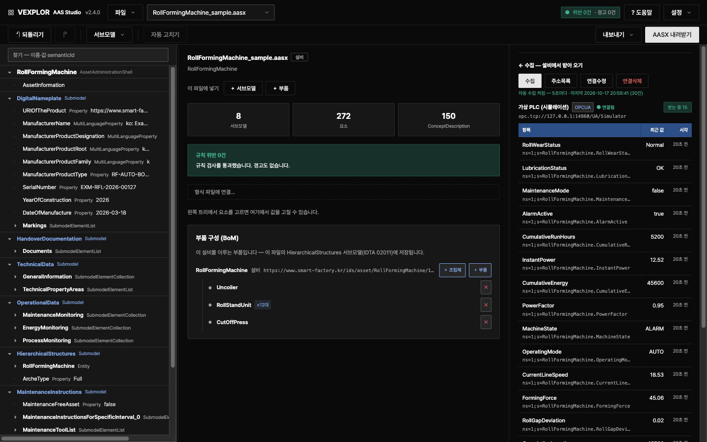

[English](README.md) · **한국어**

# VEXPLOR AAS Studio

**AAS(Asset Administration Shell)를 만들고 · 검증하고 · 내주고 · 현장 값까지 모으는 일을 웹 화면 하나로.**
설비 한 대의 AASX를 올리면 무엇이 규칙에 어긋나는지 짚어 주고, 고칠 수 있는 것은 한 번에 고칩니다.



지금까지는 도구 셋을 오가야 했습니다. 이 프로그램은 그 일을 한곳에 모으고, **AAS를 처음 다루는 사람도**
따라올 수 있게 했습니다.

| 하던 일 | 예전 도구 | 여기서는 |
|---|---|---|
| AASX 열기 · 고치기 · 내려받기 | AASX Package Explorer (설치형) | 브라우저에서 · 고칠 자리를 짚어 주고 자동으로 고칩니다 |
| 다른 시스템에 AAS 내주기 (Part 2 REST · 레지스트리) | Eclipse BaSyx 서버 | 같은 서버가 내줍니다 |
| 설비 값 모으기 · 상위 앱에 구독으로 내주기 | 별도 OPC UA 클라이언트 · 서버 | AAS 안의 AID대로 모으고, OPC UA 서버로 내줍니다 |

> 위 도구들과 제휴하거나 그 소스를 쓴 것이 아닙니다 — 같은 일을 하나로 묶었다는 뜻입니다.

**처음이라면** 첫 화면의 **「견본으로 시작하기」**를 누르십시오. 다 채운 설비 1종과 공정 구성이 열립니다.

**홈페이지:** [wace.me/platform-aas-studio](https://wace.me/platform-aas-studio)

**문서:** [사용법](docs/사용법.md) · [설치](docs/설치.md) · [배포 · 호스팅](docs/배포_호스팅.md) · [검사 규칙 44종](docs/규칙_목록.md) · [Logic Studio 와 함께 쓰기](docs/로직스튜디오.md)
— 모든 문서에 영어판이 있습니다.

---

## 왜 만들었나

**AAS는 표준으로는 갖춰졌습니다. 공장에 붙이는 일은 아직 명세서 바깥에 남아 있습니다.**

10년 치 AAS 연구를 정리한 리뷰 논문(IEEE Access, 2025)은 기존 설비 · 시스템과의 통합이 도입을 늦추는
핵심 과제라고 짚습니다. AAS를 손으로 만드는 부담도 여러 연구가 지적하고, 공개 도구는 편집기 · 서버 ·
라이브러리로 나뉘어 있어 현장 값 수집은 설정 파일로 직접 맞춰야 합니다. VEXPLOR AAS Studio는 이 일을
소프트웨어가 맡게 해서, AAS가 문서에서 끝나지 않고 **현장 설비의 값이 흐르는 운영 데이터**가 되도록
만들었습니다.

| 현장에서 부딪히는 일 | VEXPLOR AAS Studio에서 |
|---|---|
| 이미 가동 중인 설비 · PLC에 붙이기 | AAS 안의 AID대로 OPC UA · Modbus TCP · MQTT에서 값을 모읍니다. 원격 수집기는 밖으로만 보내고, PLC 프로그램은 고치지 않습니다 |
| AAS를 손으로 만드는 부담 | 다 채운 견본에서 출발하고, 값 표 · CSV로 한 번에 채우며, 규칙 44종이 짚고 19종은 자동으로 고칩니다 |
| 일마다 나뉜 도구 | 열기 · 고치기 · 검사 · Part 2 REST · 현장 값 수집 · OPC UA 내주기를 화면 하나에서 |
| 표준을 통과해도 제출처에서 떨어짐 | 국내 제출처 검증기(KOSMO Validator)의 사업 규칙(semanticId 허용 목록 · 필수 서브모델 · 패키지 구조)을 제출 전에 거르고, 표준과 어긋나는 곳은 정책으로 드러내 사용자가 정합니다 |

AAS를 실제 라인에 적용한 사례(Bosch Rexroth 등)도 있습니다. 그 사례들도 기계를 바꿀 때마다 통합에 몇 달이
걸린다고 적습니다. 근거와 원문 목록은 [docs/배경.md](docs/배경.md)에 있습니다.

> **최종 합격 판정은 제출처의 검증기가 합니다. 이 도구는 제출 전 사전 점검입니다.**

## 할 수 있는 일

| | |
|---|---|
| **열기 · 고치기** | AASX(JSON · XML)를 올려 트리로 보고 값 · 요소 · 서브모델 · 용어(ConceptDescription)를 고칩니다. 서브모델 값 표나 CSV 설비 대장으로 여러 값을 한 번에 채웁니다 |
| **검사** | 규칙 [43종](docs/규칙_목록.md) — 패키지 구조(L1) · 메타모델 제약조건(L2) · 제출처 사업 규칙(L3) |
| **자동 고치기** | 고칠 수 있는 지적(규칙 19종)을 미리 보고 골라서 한 번에 고칩니다. 무엇을 바꿨는지 이관 대장에 남습니다 |
| **검증 결과서** | 인쇄하면 PDF가 되는 HTML 결과서 |
| **채울 것 표시** | IDTA 템플릿을 설치해 두면 값 표의 줄마다 필수 · 수집 · 선택이 붙고, 「채울 것만 보기」로 나머지를 숨깁니다 |
| **되돌리기 · 이력** | 실수를 한 번에 되돌리고, 서브모델을 지난 시점으로 복원합니다 |
| **형식과 호기** | 형식 파일을 호기별로 나누고, 형식이 바뀌면 바뀐 곳을 줄마다 보고 고른 줄만 받아 옵니다 — 현장에서 고친 값은 덮지 않습니다 |
| **공정 묶음** | 회사 → 라인 → 공정 → 설비 → 부품. 설비 여러 대를 공정으로 묶어 제출용 꾸러미(레퍼런스 번들)로 내보냅니다 |
| **현장 값 수집** | OPC UA · Modbus TCP · MQTT 설비에서 값을 모읍니다. 주소는 AAS 안의 AID(Asset Interface Description) 서브모델이 정합니다. 값마다 받는 중 · 끊김 · 값 없음을 보여 주고, 설비마다 하루 상태(가동 · 정지 · 알람) 막대를 그립니다. 같은 꼴의 태그는 패턴 하나로 여러 개를 담습니다 |
| **표준 API** | IDTA Part 2 REST API — 다른 시스템이 이 서버의 AAS를 읽어 갑니다 |
| **MES · ERP · CMMS 연동** | 모든 변경과 가동 사건을 순서대로 읽어 가는 주소(CloudEvents), 서명한 웹훅과 MQTT, 설비 · BOM · 공정 계층 · 보전 계획 · 문서 목록 내보내기(JSON · CSV), AASX 옆에 보관하는 ERP 번호, 서버에서 판정하는 상태 · 알람 · 계수기 · 한계값 규칙. OPC UA 서버는 계정과 암호화로 보호합니다. [docs/연동.md](docs/연동.md) |
| **계정** | 관리자 · 편집자 · 열람자. 변경 이력에 누가 고쳤는지 남습니다 |
| **한국어 · 영어, 밝은 · 어두운 화면** | 화면 글자**와** 서버가 만드는 글(지적 문구 · 규칙 설명 · 검증 결과서 · 번들 README · 오류)이 한국어와 영어로 나옵니다. 고른 적이 없으면 브라우저 언어를 따릅니다(한국어 브라우저는 한국어, 그 밖은 영어). 밝은 화면과 어두운 화면이 있습니다 |

## 2.3 ~ 2.8 에서 새로 생긴 것

| 기능 | 판 | 내용 |
|---|---|---|
| **원격 수집기 묶음 저장 — 빠르게, 통째로** | 2.8.1 | 원격 수집기가 보낸 묶음 하나를 데이터베이스에 한 번에 저장합니다. 묶음에 든 모든 파일의 값과 「이 묶음을 받았다」는 기록이 한 트랜잭션으로 들어가, 묶음은 통째로 저장되거나 하나도 저장되지 않습니다. 전에는 값 하나마다 따로 써서, 4코어 시험 서버에서 DB 가 절반쯤 놀고 있는데도 초당 약 11,500값에서 더 받지 못했습니다. 원격 수집기 목록은 수집기마다가 아니라 요청마다 파일을 한 번만 읽고, 수집기 하나를 승인하면 그 수집기 기록만 저장합니다. DB 연결 수는 `PG_POOL_MAX` 로 정합니다(기본 10) — [설치](docs/설치.md) |
| **DB 가 멈춰도 서버 상태가 답함** | 2.8.1 | 데이터베이스가 멈추거나 밀려 답하지 않으면 「서버 상태」가 10초 넘게 걸리거나 답하지 못했습니다. 이제 7초 안팎에 답하고 저장소 연결을 「실패」로 보여 줍니다 |
| **수집 연결의 보안 · 로그인** | 2.8.0 | 「수집 연결 만들기」에서 OPC UA 보안 방식(Sign · SignAndEncrypt)과 보안 정책, OPC UA · MQTT 의 「로그인 필요」를 고릅니다. 사용자 이름 · 암호는 설비 파일에 넣지 않고 서버의 credentials 파일과 공장 PC 의 `credentials.json` 에 접속 주소로 둡니다. 「설비에서 불러오기」도 고른 보안과 로그인으로 붙습니다. 주소에 암호가 든 옛 MQTT 연결은 원격 수집기 목록에서 빠지고 검사 규칙 `AID-1` 이 알립니다(MQTT 로그인은 VEXPLOR Edge 1.1.0 이상) |
| **못 읽은 이유 저장** | 2.8.0 | 자동 수집과 원격 수집기가 못 읽은 태그의 이유를 값과 함께 저장합니다. 화면을 다시 열어도 그 줄에 「읽기 실패 — 사유」가 남고, 품질 코드가 없는 Modbus · MQTT 도 이유가 보입니다 |
| **단위 · Modbus 순서 · 읽기 주기** | 2.8.0 | 태그 줄마다 단위, Modbus 줄에 바이트 · 워드 순서(ABCD · CDAB · BADC · DCBA), 설비마다 읽기 주기를 화면에서 정합니다. 원격 수집기는 그 주기로 읽고, 「연결수정」은 지금 연결을 채운 채 열립니다 |
| **원격 수집기 상태 · 서버 상태** | 2.8.0 | 원격 수집기 목록의 줄마다 서버가 판정한 **정상 · 주의 · 위험** 배지와 이유 한 줄이 나옵니다(디스크 남은 공간 · 보내기 실패 · 시계 오차 · 설비 읽기 성공률 · 대기열 · 끊김 · 설비 연결 0). 「상태 자세히」는 공장 PC(CPU · 메모리 · 디스크 · 켜진 시간 · 시계 오차), 서버 통신, 설비별 응답 시간 · 성공률 · 재연결과 최근 24시간 추이를 보여 줍니다(VEXPLOR Edge 1.1.0 이상이 보내는 값). 관리자는 설정에서 서버 자신의 상태(저장소 연결 · 디스크 · 최근 1시간 묶음 · 판)를 봅니다. [사용법 8-8](docs/사용법.md#8-8-원격-수집기--서버가-공장-밖에-있을-때-원클릭-연결) |
| **원격 수집기 원클릭 연결** | 2.7.0 | **설정 → 원격 수집기 → 「+ 수집기 연결」** — 서버 주소와 읽을 목록을 확인하고 단추 하나를 누르면, 공장 Linux PC에 붙여 넣을 명령 한 줄이 나옵니다. 그 한 줄이 내려받기 · 해시 대조 · 설치 · 등록 · 승인까지 끝내고, 화면은 공장 PC가 붙는 순간 「받는 중」으로 바뀝니다. 같은 화면에서 마지막 수신 · 받은 값 · 설비 연결 상태를 보고 일시 정지 · 다시 시작 · 해지합니다. 관리자는 이 화면에서 원격 수집을 켭니다(`EDGE` 를 비워 둔 서버) |
| **VEXPLOR Edge 별도 오픈소스** | 2.7.0 | 원격 수집기는 이제 자기 저장소 [waceinc/vexplor-edge](https://github.com/waceinc/vexplor-edge)(Apache-2.0)에서 자기 판(1.0.0)으로 나옵니다. 규격 `vexplor.edge/1` 정본도 그곳에 있고, 이 서버는 그 규격을 그대로 받습니다 |
| **수집 칸이 저절로 갱신** | 2.7.0 | 수집 연결이 있는 파일을 열어 두면 값이 10초마다 새로 들어오고, 원격 수집기가 보낸 값이 들어오는 동안 연결 상태가 「받는 중」으로 나옵니다 |
| **설비 읽기 라이브러리** | 2.7.0 | 릴리스 꾸러미에 `@aas/collector` · `@aas/fieldbus` · `@aas/opcua` 를 더했습니다 — 원격 수집기가 이 서버와 똑같은 코드로 OPC UA · Modbus TCP · MQTT 를 읽습니다 |
| **원격 수집기 (VEXPLOR Edge)** | 2.3.0 | 공장 PC에 프로그램 하나만 두고 PLC 값을 읽어 서명한 묶음을 HTTPS로 밖에만 보냅니다 — 읽기 전용 · 밖으로만. Linux x64 · arm64 ([설치](docs/엣지설치.md)), Windows는 추후 |
| **바뀐 값만 보내기** | 2.4.0 | OPC UA 구독과 불감대(deadband). 태그 6개 · 1초 · 5분 실측: 주기 읽기 283 KB → 88 KB |
| **끊긴 동안 쌓인 값** | 2.3.0 | 통신이 끊긴 동안 읽은 묶음을 오래된 것부터 다시 보내고, 최대 `maxQueueDays`(기본 30일) 보관합니다 |
| **공장 서버 한 번에 설치** | 2.4.0 | Linux 서버 1대에 AAS Studio · 데이터베이스 · 원격 수집기를 명령 하나로 설치하고, 재부팅 뒤 스스로 다시 올라옵니다 ([현장 설치](docs/현장설치.md)) |
| **수집값 압축 · 집계** | 2.4.0 | TimescaleDB Community Edition에서 7일 지난 값을 압축하고 1분 · 1시간 집계를 만듭니다. 태그 1,000개 · 1초 · 1시간 실측: 1,099 MB → 50 MB |
| **Logic Studio 연계 안내** | 2.6.0 | **? 도움말 → VEXPLOR Logic Studio에서 쓰기**와 [docs/로직스튜디오.md](docs/로직스튜디오.md): 검사를 마친 AASX 를 내려받아 Logic Studio Cloud 설비 화면에 끌어 놓으면 설비 대장이 됩니다 — 설치도 변환도 없습니다 |
| **태그 힌트** | 2.5.0 | 읽을 목록의 태그마다 모델 요소의 `semanticId`, 제안 역할(상태 · 카운터 · 알람 · 계량 · 설비 상태 · 품질), 같은 파일의 한계값이 붙습니다. 그래서 Logic Studio 같은 받는 쪽이 역할과 SPC 규격 한계를 미리 채워 두고 사람은 확인하면 됩니다([계약 §4.1](docs/엣지계약.md)) |
| **서버 없이 읽을 목록 만들기** | 2.3.0 | `@aas/bundle` 의 `aidReadList` 가 AASX 안의 AID에서 수집기가 읽을 태그 목록을 만듭니다 — 다른 제품이 AID 해석기를 따로 만들 필요가 없습니다 |

전체 내용: [Releases](https://github.com/waceinc/vexplor-aas/releases)

## VEXPLOR Logic Studio와 바로 연결

여기서 만들고 검사한 AASX는 [VEXPLOR Logic Studio](https://wace.me/platform-logic-studio)(웨이스의 공장 통합 플랫폼 — MES · PLM · ERP · QMS)에
그대로 들어갑니다. 공장에 설치할 것도, 변환할 것도 없습니다.

1. 여기서 설비 AASX를 만들고 규칙 44종 검사를 통과시킵니다.
2. Logic Studio Cloud 설비 화면에 그 파일을 끌어 놓습니다.
3. 미리 보기에서 기종 · 설비 · 공장 · 라인을 확인하고 가져오면, 설비가 기종(Type)에 연결된 채로 설비 대장에 들어갑니다.

- 기종(Type) 파일과 설비(Instance) 파일을 나눠 받습니다.
- 같은 파일을 다시 놓으면 「바뀌는 것이 없습니다」로 끝나고, 같은 설비가 두 번 생기지 않습니다.
- 단계별 안내: [docs/로직스튜디오.md](docs/로직스튜디오.md). 앱의 **? 도움말**에도 같은 단계가 있습니다.
- **실시간 값 연결은 준비 중입니다.** 같은 원격 수집기가 Logic Studio Cloud로도 설비 값을 보내는 연결을 준비하고
  있습니다. 받는 쪽이 구현할 두 끝점은 [docs/엣지계약.md](docs/엣지계약.md)에 있습니다. 지금은 제공하지 않습니다.

## 바로 써 보기

### Docker — 가장 쉽습니다

```bash
git clone <이 저장소> && cd <폴더>
cp .env.example .env          # POSTGRES_PASSWORD만 채우면 됩니다
docker compose up -d --build
```

브라우저에서 `http://localhost:8080`. 자세한 것은 [설치.md](docs/설치.md). 인터넷이 없는 공장 서버는 현장 설치 묶음 —
[현장설치.md](docs/현장설치.md).

데이터베이스 이미지 `timescale/timescaledb` 는 Tiger Data 의 **TimescaleDB Community Edition** 이며 이 저장소의 라이선스가
아니라 Timescale License(https://www.tigerdata.com/legal/licenses)가 적용됩니다 — 사용하는 쪽 PC 의 Docker 가 Docker Hub
에서 직접 받습니다. `-oss` 이미지는 TimescaleDB Apache-2 Edition 입니다(압축 · 연속 집계 없음).

### 소스에서 — Node.js 24 LTS 권장(22 이상이면 동작)

```bash
npm install
npx tsc -b                       # 빌드
npm run build --workspace apps/web
node apps/api/dist/server.js     # http://localhost:8080
```

아무 설정 없이 띄우면 **그 컴퓨터에서만** 열립니다(127.0.0.1). 다른 사람도 쓰게 하려면
[사용법 §12](docs/사용법.md)를 보십시오.

> **띄운 뒤 가장 먼저 첫 관리자를 만드십시오**(설정 → 첫 관리자 만들기). 계정이 하나라도 생기면
> 그때부터 화면도 API도 로그인(또는 API 키)을 요구합니다. 계정이 없는 동안은 열린 서버입니다.

개발 중에는 화면을 따로 띄웁니다.

```bash
npm run dev:api     # API 8080
npm run dev:web     # 화면 5173 (다른 창에서)
```

## 구성

TypeScript 모노레포입니다. 화면도 서버도 한 언어입니다.

| 꾸러미 | 역할 |
|---|---|
| `packages/aas-core` | AAS V3.0 메타모델 타입 · 서버가 만드는 글의 한국어 · 영어 |
| `packages/aasx` | AASX(OPC 패키지) 읽기 · 쓰기 — 무손실 왕복 |
| `packages/linter` | 검사 규칙 · 자동 고치기 · 결과서 |
| `packages/store` | 저장소 — 메모리 · 폴더 · PostgreSQL이 같은 시험을 통과합니다 |
| `packages/collector` | AID를 읽어 현장 값을 모읍니다 |
| `packages/opcua` | OPC UA 클라이언트 · 서버([node-opcua](https://github.com/node-opcua/node-opcua)) |
| `packages/fieldbus` | Modbus TCP · MQTT 수집 어댑터(외부 의존성 없음 — `node:net`) · 시험용 장치와 브로커 |
| `apps/api` | REST API 서버 |
| `apps/web` | 화면(React) |

### 다른 제품에서 라이브러리로 쓰기

`@aas/core` · `@aas/aasx` · `@aas/linter` · `@aas/bundle`(서버 없이 AASX 에서 연동 묶음을 만드는 `buildBundle`) ·
`@aas/collector` · `@aas/fieldbus` · `@aas/opcua`(설비 읽기 — 원격 수집기가 사용합니다)는 GitHub 릴리스마다 npm 꾸러미 파일로 붙습니다
(`node scripts/pack-libraries.mjs`, 해시는 `SHA256SUMS`). **릴리스 주소로** 설치하십시오.

```json
"@aas/aasx": "https://github.com/waceinc/vexplor-aas/releases/download/v2.8.1/aas-aasx-2.8.1.tgz"
```

버전 번호로 설치하지 마십시오 — 공개 npm 저장소의 `@aas` 이름 공간은 우리 것이 아니어서 `"@aas/core": "^2.0.0"` 이라고
쓰면 남이 그 이름으로 올린 것이 설치됩니다. 꾸러미끼리도 릴리스 주소로 서로를 가리키므로 주소 하나만 고정하면 됩니다.

### 원격 수집기

서버가 공장 밖(클라우드 · 본사)에 있으면 공장 PC 한 대에 **VEXPLOR Edge** 를 둡니다 — 별도 오픈소스
[waceinc/vexplor-edge](https://github.com/waceinc/vexplor-edge). 승인한 목록의 PLC 만 읽어 서명한 묶음을 HTTPS 로 밖에만
보내고, 원격 정지가 없습니다. 연결은 화면 **설정 → 원격 수집기 → 「+ 수집기 연결」**에서 단추 하나와 붙여 넣기 한 줄로
끝납니다(Linux x64 · arm64, Windows 는 준비 중). 이 서버 쪽 안내: [docs/엣지설치.md](docs/엣지설치.md), 규격 사본:
[docs/엣지계약.md](docs/엣지계약.md).

## 표준 대응

| 표준 | 상태 |
|---|---|
| AAS 메타모델 **V3.0** (IDTA-01001-3-0) | 타입 고정. 3.1로 자동 올리지 않습니다 |
| AASX 패키지 (IDTA-01005) | JSON · XML 읽기, JSON 쓰기 |
| **Part 2 REST API** (IDTA-01002-3-0) | AasxFileServer 6/6 · ConceptDescription 7/7 · AAS Repository 47/54 · Submodel Repository 38/45 · Registry · Discovery 일부 |
| AID 1.1 (IDTA-02017) | OPC UA · Modbus TCP · MQTT 주소 해석(Modbus · MQTT 는 W3C WoT 바인딩 표기) |

구현 범위는 `node scripts/part2-coverage.mjs`가 규격 원문(OpenAPI)과 대조해 보여 줍니다.

## 알아 둘 것

- **인증은 켜야 적용됩니다.** 계정도 API 키도 없으면 서버는 스스로 그 컴퓨터에서만 문을 엽니다
- **OPC UA 내주는 포트(4840)는 계정 로그인과 암호화(Sign · SignAndEncrypt)가 필요합니다.** 기본은 꺼져 있고, `OPCUA_ALLOW_INSECURE=on` 으로 예전의 인증 없는 포트를 켜는 것은 외부와 분리된 시험망에서만 하십시오
- 사람이 로그인하기 시작하면 **HTTPS를 앞에 두십시오** — [`Caddyfile.example`](Caddyfile.example)
- **영어 화면에서 그대로 남는 것**은 내 파일에서 온 이름 · 값과, 제출 구조가 정한 레퍼런스 번들의 폴더 이름뿐입니다
- 서버 기동 로그는 기본이 한국어이고, `AAS_LANG=en`이면 영어입니다
- 보안 문제는 공개 이슈가 아니라 [SECURITY.ko.md](SECURITY.ko.md)에 적힌 방법으로 알려 주십시오

## 개발에 참여하기

```bash
bash scripts/ci.sh      # 빌드 → 타입 → 시험 → 규격 대조 → 생성 문서 → 라이선스 → 번역. 올리기 전에 한 번
```

CI는 Node.js 22와 24에서 실행됩니다. 지켜 주실 약속 몇 가지는 [CONTRIBUTING.ko.md](CONTRIBUTING.ko.md)에 있습니다.

## 라이선스

[Apache License 2.0](LICENSE). 고쳐 쓰고 상용 제품에 넣어도 됩니다.

Copyright 2026 WACE. 「VEXPLOR」「WACE」 이름과 로고는 WACE의 상표이며 라이선스가 사용을 허락하지 않습니다 — [NOTICE](NOTICE).
이 프로젝트가 사용하는 오픈소스는 [THIRD-PARTY-NOTICES.md](THIRD-PARTY-NOTICES.md)에 있습니다.
`docs/spec/part2/`는 IDTA가 CC BY 4.0으로 발행한 규격 원문입니다.
