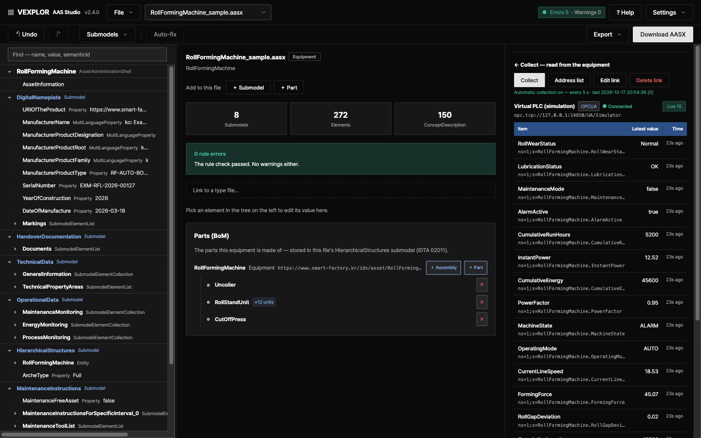

**English** · [한국어](README.ko.md)

# VEXPLOR AAS Studio

**Author, validate, serve and collect live values for AAS (Asset Administration Shell) — in one web app.**
Upload one machine's AASX, see exactly which rules it breaks, and fix what can be fixed in one step.



This used to take three tools. VEXPLOR AAS Studio brings the work together and is built so that
**people new to AAS** can follow along.

| Task | Usual tool | Here |
|---|---|---|
| Open · edit · export AASX | AASX Package Explorer (desktop) | In the browser, with findings and auto-fix |
| Serve AAS to other systems (Part 2 REST · registry) | Eclipse BaSyx server | The same server does it |
| Collect machine values · publish them by subscription | Separate OPC UA client/server | Collects per the AID in the AAS and publishes via an OPC UA server |

> Not affiliated with, and not derived from, the tools above — it combines the same jobs in one place.

**New here?** Click **"Start with a sample"** on the start screen to open a fully filled equipment file and a process structure.

**Website:** [wace.me/en-platform-aas-studio](https://wace.me/en-platform-aas-studio)

**Docs:** [Usage](docs/usage.md) · [Install](docs/install.md) · [Deployment & hosting](docs/deployment.md) · [The 44 rules](docs/rules.md) · [Using it with Logic Studio](docs/logic-studio.md)
— every document is also available in Korean.

---

## Why

**AAS is in place as a standard. Putting it into a factory is still work left outside the specification.**

A review of ten years of AAS research (IEEE Access, 2025) names integration with existing machines and
systems as a key challenge holding back adoption. Several studies point to the effort of building an AAS by
hand, and the open tools are split into editors, servers and libraries, so collecting field values means
mapping it yourself in configuration files. VEXPLOR AAS Studio lets software take on that work, so an AAS
does not end as a document but becomes **operating data with live values from the machines on the floor.**

| What people hit on the floor | In VEXPLOR AAS Studio |
|---|---|
| Attaching to machines and PLCs that already run | Collects from OPC UA, Modbus TCP and MQTT per the AID in the AAS. The remote collector sends outward only; PLC programs are not changed |
| Building an AAS by hand | Start from a filled sample, fill values at once from tables or CSV; 44 rules point out problems and 19 fix them automatically |
| One tool per job | Open, edit, check, Part 2 REST, field value collection and OPC UA publishing in one screen |
| Passing the standard, failing the receiver | Checks the Korean receiving validator's (KOSMO Validator) business rules — semantic ID allow-list, mandatory submodels, package structure — before submission, and shows conflicts with the standard as a policy the user decides |

There are real line deployments (Bosch Rexroth and others). They too report that integration can take
months whenever machines change. Evidence and sources: [docs/background.md](docs/background.md).

> The receiving validator remains the only authority on acceptance. This tool is a pre-check.

## What it does

| | |
|---|---|
| **Open & edit** | Load AASX (JSON or XML), browse it as a tree, edit values, elements, submodels and concept descriptions. Fill many values at once from a submodel value table or from a CSV equipment list |
| **Lint** | [44 rules](docs/rules.md) in three layers — package structure (L1), metamodel constraints (L2), submission business rules (L3) |
| **Auto-fix** | Preview the fixable findings (19 rules), choose, apply at once. Every relocation is recorded |
| **Report** | A printable HTML validation report |
| **What to fill** | With the IDTA templates installed, every value row shows required · collected · optional, and "Show only what to fill" hides the rest |
| **Undo & history** | One-step undo, and restore a submodel to an earlier point |
| **Types and units** | Split a type file into units; when the type changes, review the differences line by line and pull only the lines you choose — values edited on site are never overwritten |
| **Process bundles** | Company → line → process → equipment → part. Group machines into a process and export a submission bundle |
| **Data collection** | Read live values from OPC UA · Modbus TCP · MQTT devices, addressed by the AID submodel inside the AAS. Each value shows whether it is live, stale or missing, and each machine gets a daily status bar (running · stopped · alarm). Add dozens of tags from one pattern |
| **Standard API** | IDTA Part 2 REST API, so other systems can read the AAS held here |
| **MES · ERP · CMMS integration** | A pull feed of every change and runtime event (CloudEvents), signed webhooks and MQTT, equipment / BOM / hierarchy / maintenance / document exports in JSON or CSV, ERP numbers kept next to the AASX, and server-side state, alarm, counter and threshold rules. A secure OPC UA server (accounts + encryption). See [docs/integration.md](docs/integration.md) |
| **Accounts** | Admin / editor / viewer, with an audit trail of who changed what |
| **English & Korean, light & dark** | The interface **and** everything the server writes — findings, rule descriptions, the validation report, bundle README, errors — come in English or Korean. If you never choose, the browser language decides (Korean browser → Korean, anything else → English). Light and dark themes |

## What's new in 2.3 – 2.8

| Feature | Release | Detail |
|---|---|---|
| **Security and login on collection links** | 2.8.0 | "Create collection link" picks the OPC UA security mode (Sign · SignAndEncrypt) and policy, and "Login required" for OPC UA and MQTT. The user name and password never go into the equipment file — they stay in the server's credentials file and the factory PC's `credentials.json`, keyed by the endpoint. "Load from equipment" connects with the chosen security and login. An old MQTT link with a password in its address is left out of the remote collector list and rule `AID-1` says so (MQTT login needs collector 1.0.2 or later) |
| **Why a read failed is kept** | 2.8.0 | Automatic collection and remote collectors store the reason with the value. The row keeps "Read failed — reason" after the screen is opened again, and Modbus and MQTT, which have no quality code, show it too |
| **Units, Modbus order, read period** | 2.8.0 | A unit on every tag row, byte and word order (ABCD · CDAB · BADC · DCBA) on Modbus rows and a read period per machine, all on the screen. Remote collectors read at that period, and "Edit link" opens filled in with the current link |
| **One-click remote collector** | 2.7.0 | **Settings → Remote collectors → "+ Connect a collector"** — check the server address and the read list, press one button, and you get one line to paste on the factory Linux PC. That line downloads, checks the hash, installs, registers and approves; the screen turns to "Receiving" the moment the PC connects. The same screen shows the last batch, values received and machine connections, and pauses, resumes or revokes. Admins turn remote collection on right there (servers with `EDGE` empty) |
| **VEXPLOR Edge, its own open source** | 2.7.0 | The remote collector now ships from its own repository [waceinc/vexplor-edge](https://github.com/waceinc/vexplor-edge) (Apache-2.0) with its own version (1.0.0). The canonical contract `vexplor.edge/1` lives there; this server receives it as is |
| **Collect pane refreshes itself** | 2.7.0 | With a file that has a collection link open, values come in every 10 s, and while a remote collector's values arrive the connection shows "Receiving" |
| **Equipment reader libraries** | 2.7.0 | The release packages add `@aas/collector`, `@aas/fieldbus` and `@aas/opcua` — the remote collector reads OPC UA, Modbus TCP and MQTT with exactly this server's code |
| **Remote collector (VEXPLOR Edge)** | 2.3.0 | One program on the factory PC reads PLCs and sends signed batches out over HTTPS — read only, outbound only. Linux x64 · arm64 ([install](docs/edge-install.md)); Windows will be covered later |
| **Send changes only** | 2.4.0 | OPC UA subscriptions with a deadband. Measured 6 tags · 1 s · 5 min: 283 KB polling → 88 KB |
| **Values from an outage** | 2.3.0 | Batches read while the link was down are sent oldest first and kept up to `maxQueueDays` (default 30) |
| **Factory server install** | 2.4.0 | One command puts AAS Studio, the database and the remote collector on one Linux server; it comes back after a reboot ([site install](docs/site-install.md)) |
| **Compression · aggregates** | 2.4.0 | With TimescaleDB Community Edition: values older than 7 days are compressed, 1-minute and 1-hour aggregates are built. Measured 1,000 tags · 1 s · 1 h: 1,099 MB → 50 MB |
| **Logic Studio guide** | 2.6.0 | **? Help → Use it in VEXPLOR Logic Studio** and [docs/logic-studio.md](docs/logic-studio.md): download the checked AASX, drop it on Logic Studio Cloud's equipment screen, and it becomes the equipment register — nothing to install or convert |
| **Tag hints** | 2.5.0 | Each read-list tag names its model element's `semanticId`, a suggested role (state · counter · alarm · meter · condition · quality) and limits from the same file, so a receiver such as Logic Studio pre-fills roles and SPC limits for a person to confirm ([contract §4.1](docs/edge-contract.md)) |
| **Read list without a server** | 2.3.0 | `aidReadList` in `@aas/bundle` turns the AID inside an AASX into the tag list a collector reads — no AID parser needed in other products |

Full notes: [Releases](https://github.com/waceinc/vexplor-aas/releases).

## Works with VEXPLOR Logic Studio

AASX files authored and checked here import straight into
[VEXPLOR Logic Studio](https://wace.me/en-platform-logic-studio) (WACE's factory platform — MES · PLM · ERP · QMS) — nothing to install in the factory,
no conversion step.

1. Author the equipment AASX here and pass the 43-rule check.
2. Drop the file on the equipment screen of Logic Studio Cloud.
3. Check types, equipment, plant and line in the preview, then import — each machine enters the equipment register
   linked to its type.

- Type files and Instance files are imported separately.
- Dropping the same file again ends with "Nothing changes" — no duplicate equipment.
- Step-by-step guide: [docs/logic-studio.md](docs/logic-studio.md). The in-app help (**? Help**) has the same steps.
- **Live values are in preparation:** the same remote collector is being prepared to send machine values to
  Logic Studio Cloud as well. The two endpoints any receiver implements are in [docs/edge-contract.md](docs/edge-contract.md).
  Not offered yet.

## Quick start

### Docker

```bash
git clone <this repository> && cd <folder>
cp .env.example .env          # only POSTGRES_PASSWORD is required
docker compose up -d --build
```

Open `http://localhost:8080`. Details: [install.md](docs/install.md). A factory server with no internet: the site
install bundle, [site-install.md](docs/site-install.md).

The database image `timescale/timescaledb` is **TimescaleDB Community Edition** by Tiger Data, under the Timescale
License (https://www.tigerdata.com/legal/licenses) — not under this repository's licence; Docker pulls it from Docker Hub
on your machine. `-oss` images are TimescaleDB Apache-2 Edition (no compression or continuous aggregates).

### From source — Node.js 24 LTS (22 or later works)

```bash
npm install
npx tsc -b
npm run build --workspace apps/web
node apps/api/dist/server.js     # http://localhost:8080
```

With no configuration the server binds to **127.0.0.1 only**. To share it, configure accounts or
an API key first — see [Usage §12](docs/usage.md).

> **Create the first administrator right after starting** (Settings → Create the first administrator). Once any
> account exists, both the UI and the API require a login (or an API key). Until then the server is open.

For development, run the UI separately:

```bash
npm run dev:api     # API on 8080
npm run dev:web     # UI on 5173 (in another terminal)
```

## Layout

A TypeScript monorepo — one language for the front end and the server.

| Package | Role |
|---|---|
| `packages/aas-core` | AAS V3.0 metamodel types · server-side text in English and Korean |
| `packages/aasx` | AASX (OPC package) reader/writer with lossless round-trip |
| `packages/linter` | Rules, auto-fixes, reports |
| `packages/store` | Storage — in-memory, folder and PostgreSQL pass the same conformance suite |
| `packages/collector` | Resolves AID and collects field values |
| `packages/opcua` | OPC UA client and server ([node-opcua](https://github.com/node-opcua/node-opcua)) |
| `packages/fieldbus` | Modbus TCP · MQTT collection adapters (no external dependencies — `node:net`) · test device and broker |
| `apps/api` | REST API server |
| `apps/web` | React front end |

### Using the libraries in another product

`@aas/core`, `@aas/aasx`, `@aas/linter`, `@aas/bundle` (the integration bundle built from AASX files without a
server — `buildBundle`) and `@aas/collector`, `@aas/fieldbus`, `@aas/opcua` (equipment readers — the remote collector
uses them) are attached to each GitHub release as npm tarballs (`node scripts/pack-libraries.mjs`,
checksums in `SHA256SUMS`). Install them **by release URL**:

```json
"@aas/aasx": "https://github.com/waceinc/vexplor-aas/releases/download/v2.7.0/aas-aasx-2.7.0.tgz"
```

Never by version number — the `@aas` scope on the public npm registry is not ours, so `"@aas/core": "^2.0.0"` would
install whatever someone else publishes there. The tarballs point at each other by release URL, so one pinned URL is
enough.

### Remote collector

When the server is outside the factory (cloud, head office), put **VEXPLOR Edge** on one factory PC — its own open
source, [waceinc/vexplor-edge](https://github.com/waceinc/vexplor-edge). It reads only the PLCs of an approved list and
sends signed batches out over HTTPS — outbound only, no remote stop. Connecting is one button and one pasted line under
**Settings → Remote collectors → "+ Connect a collector"** (Linux x64 · arm64; Windows in preparation). This server's
side: [docs/edge-install.md](docs/edge-install.md); the contract copy: [docs/edge-contract.md](docs/edge-contract.md).

## Standards

| Standard | Status |
|---|---|
| AAS metamodel **V3.0** (IDTA-01001-3-0) | Pinned. Not auto-upgraded to 3.1 |
| AASX package (IDTA-01005) | Reads JSON and XML, writes JSON |
| **Part 2 REST API** (IDTA-01002-3-0) | AasxFileServer 6/6 · ConceptDescription 7/7 · AAS Repository 47/54 · Submodel Repository 38/45 · partial Registry and Discovery |
| AID 1.1 (IDTA-02017) | OPC UA · Modbus TCP · MQTT address resolution (Modbus · MQTT use the W3C WoT binding notation) |

`node scripts/part2-coverage.mjs` compares the implementation against the specification's OpenAPI
files and prints the exact coverage.

## Things to know

- **Authentication is opt-in.** With neither accounts nor an API key the server only listens on
  the local machine.
- **The OPC UA server (port 4840) requires an account and encryption** (Sign / SignAndEncrypt). It is off by default;
  `OPCUA_ALLOW_INSECURE=on` restores the old unauthenticated port for isolated test networks only.
- Once people sign in, **put HTTPS in front** — see [`Caddyfile.example`](Caddyfile.example).
- In English, what stays as it was written is what comes from your own files (names, values) and the
  folder names of the submission bundle, which the submission format fixes.
- Server startup logs are Korean by default; set `AAS_LANG=en` for English.
- Report security problems through the channel in [SECURITY.md](SECURITY.md), not a public issue.

## Contributing

```bash
bash scripts/ci.sh      # build → typecheck → tests → spec coverage → generated docs → licenses → i18n
```

CI runs on Node.js 22 and 24. See [CONTRIBUTING.md](CONTRIBUTING.md).

## License

[Apache License 2.0](LICENSE). You may modify it and ship it in commercial products.

Copyright 2026 WACE. The names and logos "VEXPLOR" and "WACE" are trademarks of WACE and are not licensed for use — see
[NOTICE](NOTICE). Dependencies are listed in [THIRD-PARTY-NOTICES.md](THIRD-PARTY-NOTICES.md).
`docs/spec/part2/` contains the specification published by the IDTA under CC BY 4.0.
